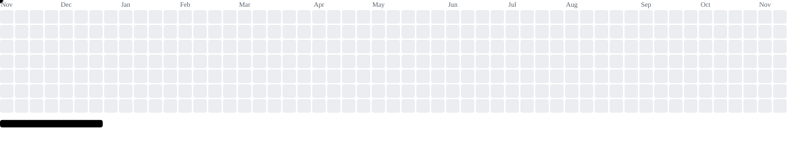

<h1 align="center">Hi, I'm <a href="https://youtu.be/dQw4w9WgXcQ?si=hontSu_YvKAQK3DK" target="_blank">Vad</a> 
</h1>

<tr>
  <td valing="top" width="450">
    
  </td>
  <td valing="top" width="250">
    
  </td>
</tr>

<picture>
    <source media="(prefers-color-scheme: dark)" srcset="https://raw.githubusercontent.com/vadbroplay/vadbroplay/output/breakout-contribution-graph-dark.svg">
    <source media="(prefers-color-scheme: light)" srcset="https://raw.githubusercontent.com/vadbroplay/vadbroplay/output/breakout-contribution-graph.svg">
    
</picture>

